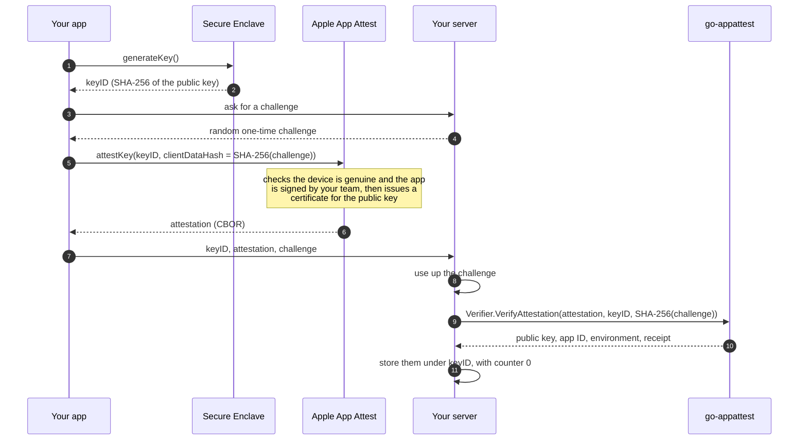
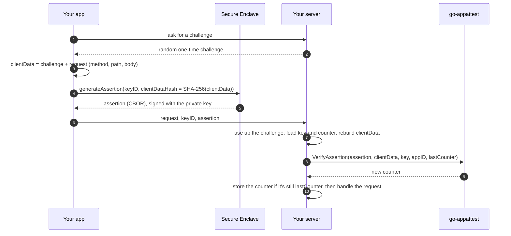
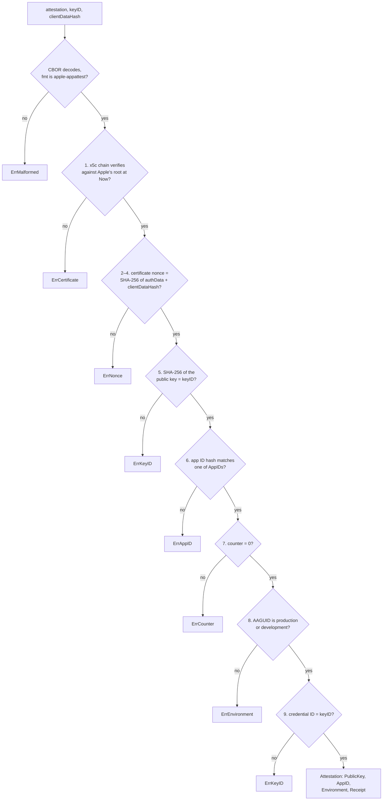
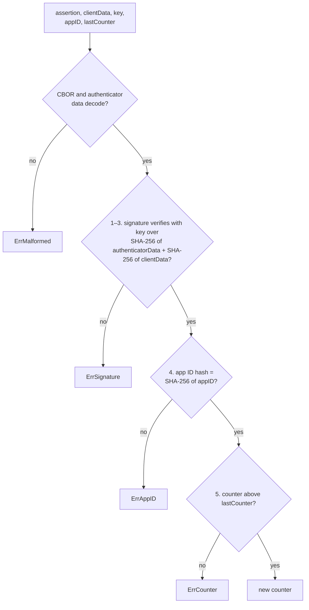

# go-appattest

Server-side verification of Apple
[App Attest](https://developer.apple.com/documentation/devicecheck/establishing-your-app-s-integrity)
for Go. It checks that a request comes from a genuine copy of your iOS app,
running on a real Apple device.

- Follows Apple's
  [Validating apps that connect to your server](https://developer.apple.com/documentation/devicecheck/validating-apps-that-connect-to-your-server)
  step by step, with the step numbers in the code.
- Uses Go's standard `crypto/x509`, `crypto/ecdsa` and `crypto/sha256`, plus
  [`fxamacker/cbor`](https://github.com/fxamacker/cbor) to decode CBOR.
- No network calls, no storage, no global state. Apple's App Attestation Root
  CA is embedded.
- Tested against the sample attestation in Apple's guide, and against a test
  certificate chain for every way a check can fail. Parsers are fuzzed.

Not affiliated with Apple. App Attest and DeviceCheck are Apple's.

```sh
go get github.com/o2ba/go-appattest
```

Requires Go 1.25 or later.

## How App Attest works

Four parties take part:

| Party | Role |
| --- | --- |
| **Your app** | Calls `DCAppAttestService` on the device |
| **Secure Enclave** | Makes a P-256 key pair whose private key never leaves the device |
| **Apple's App Attest service** | Checks the device and the app, then vouches for the key with a certificate |
| **Your server** | Issues challenges, stores keys, and calls this library |

It happens in two phases. A key is registered once per install, then every
request after that is signed with it.

### 1. Registering a key (attestation)



The attestation is a CBOR map:

| Field | Holds |
| --- | --- |
| `fmt` | Always `apple-appattest` |
| `attStmt.x5c` | Certificate chain: a credential certificate for the device's public key, then Apple's intermediate |
| `attStmt.receipt` | Apple's receipt, for the fraud metric API |
| `authData` | Authenticator data: app ID hash, flags, counter (0), environment (AAGUID) and key ID |

Apple signs the credential certificate, and it carries a nonce that binds the
certificate to this `authData` and to your challenge. That's why nothing in
`authData` needs a signature of its own.

### 2. Checking a request (assertion)



Apple isn't involved here: the device signs on its own, and your server checks
the signature against the key it stored. The assertion is a CBOR map of
`signature` and `authenticatorData` (app ID hash, flags and a counter that
goes up with every assertion).

## What the library checks

### `Verifier.VerifyAttestation`



### `VerifyAssertion`



Step 6 of Apple's assertion checks, confirming the challenge in the client
data, is your server's job, because your server builds the client data.

## Usage

### Register a key

```go
v := &appattest.Verifier{AppIDs: []string{"ABCDE12345.com.example.app"}}

// Use up the challenge first: it must be yours, unused and recent.
clientDataHash := sha256.Sum256([]byte(challenge))
a, err := v.VerifyAttestation(attestation, keyID, clientDataHash[:])
if errors.Is(err, appattest.ErrInvalid) {
	// 401: not a genuine app
}
// Store under keyID: a.PublicKey, a.AppID, a.Environment, counter 0.
```

`keyID` is the raw 32 bytes: `generateKey` returns it base64-encoded. The app
ID is your team ID and bundle ID. List every app ID you accept, such as a
separate debug bundle ID.

### Check a request

```go
// Use up the challenge, load the key and its counter, rebuild clientData.
counter, err := appattest.VerifyAssertion(assertion, clientData, key, appID, lastCounter)
if errors.Is(err, appattest.ErrInvalid) {
	// 401
}
// Store counter only if the stored one is still lastCounter (a conditional
// write), so the same assertion can't pass twice.
```

The client data's layout is up to you, as long as the app and the server
build the same bytes. Include the challenge and everything about the request
that an attacker shouldn't be able to change.

### What your server is responsible for

| What | Why |
| --- | --- |
| Challenges: random, single use, short-lived | Without them, an attestation or request can be replayed |
| Putting the challenge and the request (method, path, body) in client data | So a captured assertion can't be reused for another request |
| Storing the counter with a conditional write | So two copies of a request can't both pass |
| Deciding what to accept from `Development` keys | They come from builds with the development App Attest entitlement |

## Errors

Every rejection wraps `ErrInvalid`, plus one reason: `ErrMalformed`,
`ErrCertificate`, `ErrNonce`, `ErrKeyID`, `ErrAppID`, `ErrCounter`,
`ErrEnvironment` or `ErrSignature`. Answer the client the same way for all of
them and log the reason. Misuse (a `Verifier` without `AppIDs`, a nil key)
returns an error that doesn't wrap `ErrInvalid`.

## Apple's root

Attestations are checked against Apple's
[App Attestation Root CA](https://www.apple.com/certificateauthority/Apple_App_Attestation_Root_CA.pem),
which is embedded and valid until 15 March 2045. It's used only when a key is
registered. Set `Verifier.Roots` to use a different pool, for tests or if
Apple rotates the root.

## Not covered

- macOS App Attest (iOS and iPadOS only for now)
- Apple's fraud metric API (the `Receipt` is returned for it)

## Development

```sh
go vet ./... && go test -race ./...
go test -run='^$' -fuzz=FuzzVerifyAttestation -fuzztime=1m .
go test -run='^$' -fuzz=FuzzVerifyAssertion -fuzztime=1m .
```

Security issues: see [SECURITY.md](SECURITY.md).

## License

[MIT](LICENSE)
